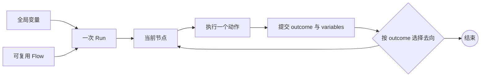

# Flow 概览

Flow 是一条可复用的工作路径。它把一类任务通常要经过的工作节点、判断结果、返工路径和必要的并行检查写成 Markdown。Flow 不保存某次任务的临时状态，也不替某次任务设定具体目标。

精确的文件格式见[Flow 规范](flow-spec.md)。目录组织约定见其中的“Flow 包目录”章节。

## 四个概念

```text
任务目标   本次 Run 要完成的具体目标
Flow      处理这类目标可以复用的工作路径
Run       某个目标按某个 Flow 执行的一次实例
NodeRun   这次 Run 实际访问某个节点的一次记录
```

Flow 启动参数只提供元信息中声明的全局变量。全局变量在当前 Run 内持续存在，节点结果中的其他变量只传给实际进入的下一节点。

## Flow 文件

每个 Flow 文件包含四部分：

| 部分 | 作用 |
| --- | --- |
| 元信息 | 说明路径和全局变量 |
| Mermaid 图 | 定义节点、结果去向、循环和并行关系 |
| 节点动作区 | 定义每个节点执行一个 Agent 或命令动作 |
| 结果说明 | 定义结果边和下一跳变量 |

`FLOW.md` 父目录名是 Flow 标识。入口文件只描述通用路径，不包含某次运行的状态或结果。

## Run 如何沿路径执行



运行时为首节点提供 `{var.xxx}` 全局变量。普通节点同时可读取上一节点传来的 `{input.xxx}`。并行汇合节点还可读取本轮各分支隔离的 `{branch.<分支引用>.<变量>}`。

`outcome` 只选择结果边。结果说明中声明的变量通过 `variables` 传递：若名称属于元信息 `variables`，写入 Run 全局状态；其他变量只进入下一节点的 `input`。未声明的变量不能提交。

每次进入节点都会创建一条 NodeRun。返工再次访问同一节点时，会产生新的 NodeRun，不覆盖历史记录。

## 节点动作和结果

一个节点只执行一个动作：

- `新建Agent`：创建一次 Agent 访问，会话是否按节点名复用由宿主决定。
- `执行自定义命令`：执行 Flow 中定义的 JSON 命令。
- `confirm`：人工确认门禁，渲染提示后挂起并等待选边。


Agent 节点从声明的结果边中选择一个，并提交 `outcome` 与可选的 `variables`。命令节点固定提交 `已执行`，命令输出只有在声明 `output: "variables"` 时才把 `{"variables": {...}}` 信封解析为业务变量，执行证据由宿主单独保存。

## 并行与返工

并行开始点保存当前输入快照，并把它复制给各分支。分支输出按分支引用隔离，汇合节点使用 `{branch.<分支引用>.<变量>}` 读取。汇合结果重新作为普通 `{input.xxx}` 传给下一节点。再次进入并行点会启动新轮次，不混用历史分支数据。

## 运行记录

宿主记录运行状态和路径。每次节点访问记录输入、`result`、变量、时间和执行依据。Agent 节点关联模型会话，命令节点关联命令执行证据，并行步骤关联本轮分支与汇合关系。

Flow 是工作方法，Run 是一次执行，观测只解释执行事实，不改变流程路由。方法发生变化时创建新的 Flow 定义，已开始的 Run 继续使用原定义。
