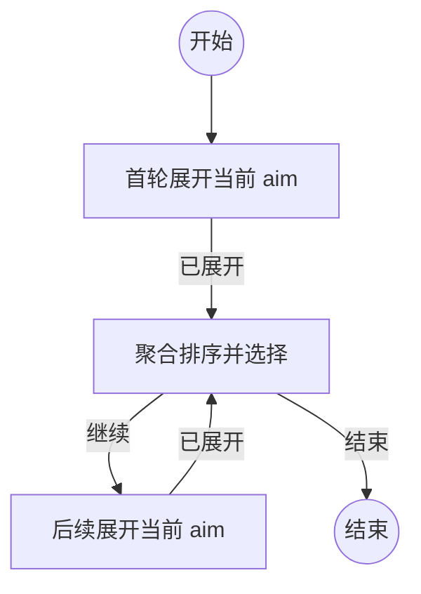

## 首轮展开当前 aim

```新建Agent
围绕开放探索目标展开首轮探索：

任务：{var.任务}
图：{var.图}

先调用 read_graph 读取图。如果图不存在，调用 create_graph 创建名为“图”的 GraphLite 图，并使用以下 Treelite schema：
{"nodeTypes":["aim","chance_path"],"edgeRules":[{"edgeType":"explore","fromNodeType":"aim","toNodeType":"chance_path"},{"edgeType":"explore","fromNodeType":"chance_path","toNodeType":"aim"}]}
图已存在时不要重复创建。确认当前图后，把任务作为根 aim；如果图中还没有对应的 aim，先追加一个 aim 节点。根据探索目标自由拆分探索角度，按需要启动任意数量的 subagent，并可为不同 subagent 自由选择合适的模型或角色。不要预设固定数量、固定候选结构、评分字段或问题空间。

汇总 subagent 的探索结果后，调用 apply_graph_changes 追加本轮发现的 aim 节点、chance_path 节点和 explore 边。只追加有依据的探索对象和关系。将本轮仍值得聚合判断的候选作为“当前候选”提交给下一节点。完成后调用 submit_flow_outcome。
```

### 已展开

| 变量 | 含义 |
| --- | --- |
| 当前候选 | 本轮追加并仍需聚合判断的候选 aim 或 chance_path，内容由本轮探索决定 |

首轮探索已写入图，并将本轮候选传给聚合节点。

## 后续展开当前 aim

```新建Agent
继续围绕开放探索目标展开下一轮：

任务：{var.任务}
图：{var.图}
下一轮 aim：{input.下一轮aim}

先调用 read_graph 读取当前图，确认已有 aim、chance_path 和 explore 关系，再围绕下一轮 aim 展开。按需要启动任意数量的 subagent，并可为不同 subagent 自由选择合适的模型或角色。不要预设固定数量、固定候选结构、评分字段或问题空间。

汇总 subagent 的探索结果后，调用 apply_graph_changes 追加本轮发现的 aim 节点、chance_path 节点和 explore 边。只追加有依据的探索对象和关系。将本轮仍值得聚合判断的候选作为“当前候选”提交给下一节点。完成后调用 submit_flow_outcome。
```

### 已展开

| 变量 | 含义 |
| --- | --- |
| 当前候选 | 本轮追加并仍需聚合判断的候选 aim 或 chance_path，内容由本轮探索决定 |

后续探索已写入图，并将本轮候选传给聚合节点。

## 聚合排序并选择

```新建Agent
读取并聚合当前探索结果：

任务：{var.任务}
图：{var.图}
当前候选：{input.当前候选}

调用 read_graph 读取完整图，将当前候选与图中已有上下文对照。合并语义相同或明显重复的候选，按对任务的推进价值排序，并选择是否继续探索。选择继续时，只提交一个下一轮最值得展开的 aim；选择结束时，说明已经没有值得继续的探索方向，或任务目标已经得到足够支持。不要提交评分字段、固定候选字段、问题空间或其他额外结果变量。完成后调用 submit_flow_outcome。
```

### 继续

| 变量 | 含义 |
| --- | --- |
| 下一轮aim | 下一轮唯一要展开的 aim |

已选出下一轮 aim，流程回到后续展开节点。

### 结束

探索已经达到可结束状态，流程完成。
