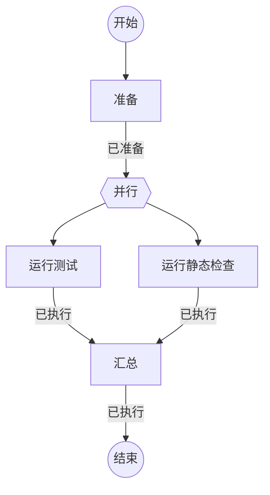

## 准备

```新建Agent
为「{var.任务}」准备检查清单。
```

### 已准备

| 变量 | 含义 |
| --- | --- |
| 清单 | 待检查项 |

清单已准备好。

## 运行测试

```执行自定义命令
{
  "command": "npm",
  "args": ["test"],
  "stdin": {"清单": "{input.清单}"},
  "output": "variables"
}
```

### 已执行

| 变量 | 含义 |
| --- | --- |
| 测试结果 | 测试输出摘要 |

命令也可以同时写全局变量：`测试状态` 由分支直接提交，并行完成后合并到全局。

## 运行静态检查

```执行自定义命令
{
  "command": "npm",
  "args": ["run", "check"],
  "output": "variables"
}
```

### 已执行

| 变量 | 含义 |
| --- | --- |
| 检查结果 | 静态检查摘要 |

## 汇总

```执行自定义命令
{
  "command": "node",
  "args": ["scripts/merge.mjs"],
  "stdin": {
    "test": "{branch.test.测试结果}",
    "lint": "{branch.lint.检查结果}"
  },
  "output": "variables"
}
```

### 已执行

| 变量 | 含义 |
| --- | --- |
| 结论 | 汇总结论 |
