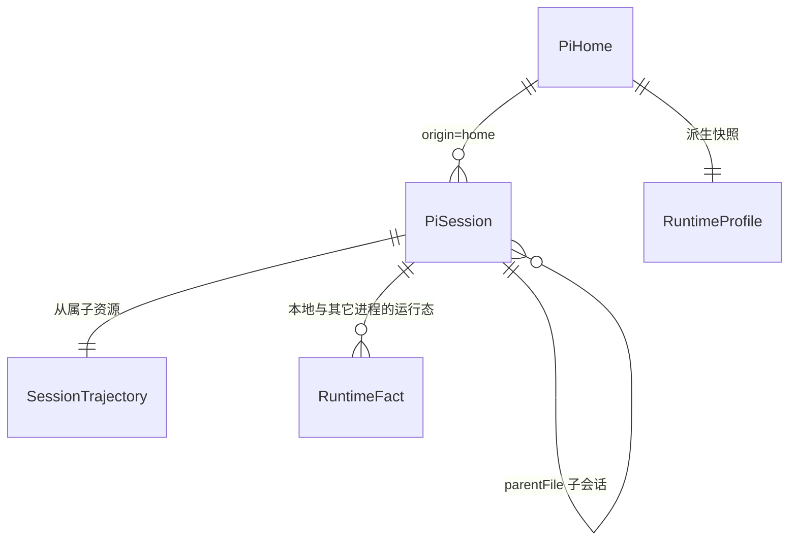
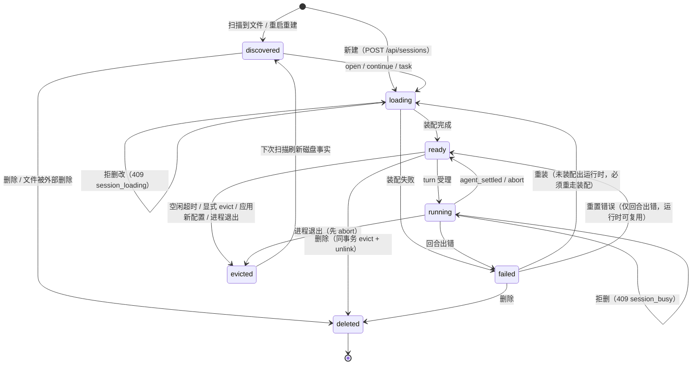
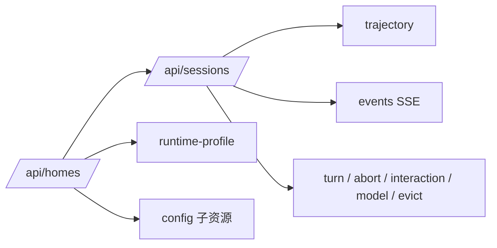

# Pi Web 架构：领域建模先行

`pi-web` 不是把三个进程塞进一个端口，而是让对话、会话、配置操作同一套领域模型。本文只写模型、状态机与契约；目录结构、环境变量、部署与迁移在模型定稿之后另文。前端结构见 `SINGLE-SIDEBAR.md`。

结论先行：

- 三个实体加一个值对象：`PiHome`（聚合根）、`PiSession`（统一会话）、`SessionTrajectory`（会话的从属子资源）、`RuntimeProfile`（派生快照，值对象）。凡是跨两个页面读写的对象都进这套模型。
- 会话身份只有 `sessionId` 一个：磁盘历史、内存加载、SSE 运行的对话、一次性任务、子会话，都是同一个 `PiSession` 的不同状态投影。`/api/live`、`/api/tasks`、`/api/chat/*` 全部收编。
- 一致性靠「字段唯一写者 + 每会话串行状态机 + 带 epoch 的版本号」，不靠对账、轮询猜测或跨模块补丁。
- 本文明确区分 v1 与 v2：v1 只做「统一实体 + 单一权威 + 整体重发」，条目级增量同步、集合增量合并留到 v2 验收。混在一起会得到一个更难调试、却没证明更省事的系统。

## 1 领域模型与实体关系



`SessionTrajectory` 是 `PiSession` 的从属子资源，不是对等实体：它没有独立生命周期（会话删除即消失），也不需要自己的集合与版本空间；它有独立写者（扫描器 / 运行时）与独立读取节奏，所以单独一个子端点而不是塞进实体字段。

### 1.1 PiHome（工作空间聚合根）

一份 home 决定整套能力：settings、凭据、skills、agents、MCP、模型目录。选 home 就选完了一切，不再分别问模型目录、agent 清单与会话根。

| 字段 | 说明 | 归属 |
| --- | --- | --- |
| `id` | realpath 的 sha256 前 16 位，跨重启稳定 | 登记时生成 |
| `name` / `path` / `description` | 显示名、绝对路径、说明 | config 域写入 |
| `origin` | `registered` / `discovered` | config 域写入 |
| `validity` | `{ ok, missing[] }`，缺 `settings.json` 等时给出缺失项 | 派生 |
| `sessionsRoot` | `<path>/sessions`，会话默认根 | 派生 |
| `capabilities` | skill / agent / mcp / plugin 数量、默认模型、凭据是否可用 | 派生 |
| `profileRevision` | 配置快照版本，任何配置写入递增 | 派生 |

不放进实体：会话总数与运行中数量。它跨聚合、随会话高频变化，而前端 store 本来就持有全量会话，一条 selector 即可；服务端重复计算会拖重 home 列表并造出第二真源。

### 1.2 PiSession（统一会话实体）

| 分组 | 字段 | 说明 |
| --- | --- | --- |
| 身份 | `id` | 会话头 `SessionHeader.id`。服务端创建时用 uuidv7 铸造，经 `SessionManager.create(cwd, dir, { id })` 交给 `createAgentSession({ sessionManager })`，文件头自动记录同一个 id；`IdentitySource` 为 `minted` |
| 身份 | `identitySource` | `minted`（服务端铸造 uuidv7 写入会话头）/ `header`（老文件自带头部 id）/ `derived`（无头文件，按 `(filePath, 首行内容)` 哈希派生，见 1.5） |
| 归属 | `origin` | `{ kind: 'home', homeId }` 或 `{ kind: 'external', rootPath }`。运行时登记的会话按 home 写入，之后不变；扫描登记的会话跟着扫到它的作用域走。按 `root=` 访问时，`root` 正好是某个已登记 home 的 `sessions/` 就按 home 算（`originOfRoot`），否则是 external。这样侧栏按目录取列表与 `createChat` 登记的是同一个作用域 |
| 归属 | `kind` | `chat` / `task` / `cli` / `subagent`，决定默认 UI、配额分桶与回收策略 |
| 结构 | `parentFile` | 头部 `parentSession` 的事实值。`parentId` 是由文件反解出的可空派生，不存字段 |
| 持久化 | `persistence` | `memory`（已创建但还没有消息，尚未落文件）/ `file` |
| 磁盘事实 | `filePath` / `cwd` / `title` / `disk` | `title` 优先，没名字时用 `firstMessage`；本服务端开的对话在首条消息的 `agent_start` 时经 SDK `setSessionName` 用首条用户消息命名，名字写进会话文件的 `session_info` 条目，`/name` 改过的不再覆盖。原说明： `disk` 含 `size`、`mtime`、`format`、`messageCount`、`firstMessage`、`createdAt`、`updatedAt`、`fileSessionId` |
| 生命周期 | `state` / `stateSince` / `error` | `error` 带 `phase: 'assemble' \| 'turn'`，决定 `failed` 的恢复路径（见第 2 节） |
| 运行 | `runtimes[]` | 每项 `RuntimeFact { instanceId, origin: 'local' \| 'process', host, pid, status, updatedAt }`；本进程直接写，其它进程由心跳补。心跳先于扫描到达时先按心跳里的路径与目录建 `discovered` 占位实体，扫到后由扫描认领 |
| 运行 | `model` / `queue` / `interactions[]` | 当前模型与思考级别、排队输入数、待回执的扩展 UI 请求 |
| 执行 | `execution?` | 仅 `kind: task`：`{ timeoutMs, outcome: 'ok' \| 'error' \| 'cancelled', outputLength, lastText }` |
| 配置 | `profileRevision` | 装配时钉住的版本；`stale` 是 `state ≠ discovered 且 profileRevision < home.profileRevision` 的派生值，不存字段 |
| 能力 | `capabilities` | 由状态与 origin 派生的布尔与原因码：`canLoad`、`canTurn`、`canEvict`、`canDelete`、`canContinue` |

同构规则：

- 外部目录会话 `homeId` 为空，其余字段与 home 会话完全一致，列表、轨迹、关注、删除、续聊走同一套逻辑。它不能直接开新回合，因为本机没有它的 `RuntimeProfile`；续聊时由用户显式选一个 home 提供 profile，profile 记在 runtime 上，`origin` 不变。这是领域差异，不是权限差异。
- 子会话是独立实体（自己的 id 与文件），不是父会话的一条记录。列表按 `parentFile` 折叠为一组，不产生第二套模型。
- 跨进程会话（pi CLI、别的机器）同样进这张表，`runtimes` 里 `origin: 'process'` 加 `host`/`pid`；状态点、是否可打开轨迹都由这一处派生。

### 1.3 SessionTrajectory（会话轨迹，从属子资源）

一条会话对外只有一个轨迹：磁盘历史与正在输出的一轮合并成同一个列表，前端不做「历史一份、增量一份」的拼接。

| 字段 | 暴露 | 说明 |
| --- | --- | --- |
| `sessionId` / `revision` | 是 | 轨迹版本；追加、替换、文件被重写时递增或重置 |
| `entries[]` | 是 | 归一化条目（原服务端 `canonicalize` 的产物），每条带稳定 `entryId`、`parentId`、`role`/`kind`、`timestamp` |
| `tail` | 是 | 进行中的条目：`{ entryId, kind: text \| thinking \| tool, text, toolName?, status }` |
| `complete` / `truncated` | 是 | 是否读到文件末尾；超上限截断标记 |
| `source` | 内部 | `file` 或 `runtime`，只影响服务端合并策略，不进主契约 |
| `watermark` | 内部 | 文件字节位置与行数的实现指纹，用于增量重读，不出接口 |

稳定 `entryId`：条目自带 `id` 时直接用；缺 id 的老行服务端按 `(fileSessionId, 行号)` 派生，因此从不同偏移分页读到的同一条目 id 一致，合并不会重复。

### 1.4 RuntimeProfile（受管配置快照，值对象）

`config` 写文件，`chat` 消费的是服务端派生出的不可变快照。它是值对象：无 id、无生命周期、可随时重建。

```ts
RuntimeProfile {
  homeId
  revision                      // 配置内容变化即递增
  models: {
    available: ModelSpec[]      // 该 home 运行时可用的全部模型
    candidates: ModelCandidate[] // 已按 enabledModels 解析并排序的候选（含 provider 显示名、显示名、支持的思考档位与档位映射）
    enabled: ModelId[]
    default: ModelId
  }
  subagents: SubagentSpec[]     // 会话内 subagent 选择器的唯一来源
  mcp: McpServerSummary[]
  credentials: { provider, status: 'ok' | 'missing' | 'expired' }[]
  tools: ToolPolicy
  cwdDefault
  catalog: { fetchedAt, providers }   // 扩展 provider 的运行时目录，只在这里可见；不设 revision
  warnings: string[]
}
```

`candidates` 由服务端用 pi 的解析器算出，前端不重写 `enabledModels` 的匹配规则，否则会立刻破坏这条反模式约束。

生效与失效机制：

1. 配置写入返回新的 `profileRevision` 与 `capabilities`，同一响应内完成，不额外拉取。
2. 装配会话时把当次 `profileRevision` 钉在 `PiSession.profileRevision`。
3. 配置写入后，该 home 下 `ready` 会话立即 `stale`；`running` 会话在 `agent_settled` 后转 `stale`；`discovered` 会话不受影响。`stale` 不入状态机，是纯派生比较。
4. `stale` 会话仍可读可续，界面提示「配置已更新」；用户点应用 = 同一实体上 evict → load，id 与文件都不变。

`catalog` 与 `revision` 分开：配置文件变化是即时的，扩展 provider 的目录要靠一次显式采集（会加载扩展、可能超时或 503），不能混进同一个版本号触发全量重采集。

### 1.5 唯一标识与版本

| 标识 | 生成规则 | 作用域 |
| --- | --- | --- |
| `homeId` | realpath sha256 前 16 位 | 全局 |
| `sessionId` | uuidv7，创建时铸造并写入会话头；老文件取头部 id；无头文件按 `(filePath, 首行内容)` 的 sha256 派生，不写磁盘 | 全局 |
| `instanceId` | 每次装配运行时生成，写进心跳文件 | 运行时实例 |
| `entryId` | 条目自带 id，缺失时按 `(fileSessionId, 行号)` 派生 | 会话内 |
| `trajectory.revision` | 每会话单调递增，文件被整体重写时重置并标记 `reset` | 会话内 |
| `profileRevision` | 按 home 单调递增 | home 内 |
| `collectionRevision` | `{ epoch, value }`，`epoch` 是进程实例 id，任何语义变化递增 | 全局 |
| `interactionId` | 服务端分配 | 会话内 |

`epoch` 是必须的：进程重启后 `value` 归零，客户端持旧游标请求会永远拿到空结果。游标 epoch 不匹配时服务端返回 `resetRequired`，客户端整份重取。

无头老文件不补写头部：补一行头部要整文件重写，遇到只读外部目录、外部占用或写权限缺失就会失败，而浏览这类文件本来不需要写盘。因此 `identitySource: 'derived'` 的会话是只读实体：`capabilities.canRun=false`、原因码 `legacy_without_header`，可看轨迹、可删除、可关注，续聊入口禁用并给出原因。需要可续聊时另做显式「接管」动作（重写头部，v2），不在扫描路径上偷偷写文件。派生 id 随路径变化：文件被移动视为新会话。

心跳的 `updatedAt` 不算语义变化：只有 `status` 迁移、实体增删、磁盘事实变化才递增 `collectionRevision`，否则每个运行中会话每 15 秒都会制造一次变更，游标优化退化。

### 1.6 读写归属（Single Source of Truth）

| 数据 | 唯一写者 | 读者 | 可重建 |
| --- | --- | --- | --- |
| Home 注册表字段 | config 域 | 侧栏、会话页、配置页 | 否 |
| Home 派生字段（`sessionsRoot`/`capabilities`/`profileRevision`） | 派生服务 | 侧栏、会话页、配置页 | 是 |
| `PiSession.origin`/`kind`/`identitySource` | 运行时登记时写一次不再变；扫描登记的 `origin` 随扫到它的作用域改写 | 侧栏、会话页、配置页 | 否 |
| `PiSession.seenAt` | 注册时写；之后只在实质变化（状态、文件、标题）时刷，心跳不刷 | 列表排序兜底、外部根回收 | 否 |
| `PiSession.persistence` | 首条消息落盘时由运行时写一次 | 侧栏、会话页、配置页 | 是（看文件是否存在） |
| `PiSession.disk` | 扫描器 | 侧栏、会话页、配置页 | 是 |
| `PiSession.state`/`error`/`queue`/`interactions`/`execution` | SessionService 状态机 | 侧栏、会话页、配置页 | 否（重启回落 `discovered`） |
| `PiSession.runtimes[i]` | 本进程由运行时注册表写；其它进程由心跳读取器写自己那一项 | 侧栏、会话页、配置页 | 是 |
| `SessionTrajectory.entries` | 按 `source` 单一归属：`file` 归扫描器，`runtime` 归运行时 | 侧栏、会话页、配置页 | 是 |
| `SessionTrajectory.tail` | 运行时 | 侧栏、会话页、配置页 | 否 |
| RuntimeProfile | 派生服务（按 home + revision 缓存） | 侧栏、会话页、配置页 | 是 |
| 偏好（特别关注） | sessions 域 | sessions | 否 |

规则：每个字段只有一个写者；读者从不写；集合与单条是同一份对象；索引缓存只是 `disk` 的持久化副本，可随时丢弃重扫。

## 2 核心状态机



`loading`、`evicted` 是运行时有无的两端。`failed` 有两种来源，恢复路径不同：

- `loading → failed`：从未装配出运行时，必须经 `loading` 重装才能到 `ready`；
- `running → failed`：运行时仍在，可原地重置错误直接回 `ready`。

`stale`（配置落后）、`persistence: memory`、`queue` 都不进状态机：它们是派生值或计数器。

### 2.1 转移表与守卫

| 从 | 到 | 触发 | 守卫与副作用 |
| --- | --- | --- | --- |
| — | `loading` | `POST /api/sessions` | 先铸造 `sessionId` 与实体（`discovered`→`loading` 同一事务内完成），再进单飞队列 |
| `discovered` | `loading` | 打开、续聊、起任务 | `origin=home` 或已给 `profileHomeId`；单飞队列（同 `sessionId` 的第二次请求 await 同一次装配） |
| `loading` | `ready` | 装配成功 | 钉住 `profileRevision`；登记 `RuntimeFact(instanceId)` 与心跳 |
| `loading` | `failed` | 装配失败 | 保留实体与 `error`，不删文件；恢复只能走 `failed → loading` |
| `failed` | `loading` | 重装 | 仅当 `error.phase = 'assemble'`，即从未装配出运行时 |
| `ready` | `running` | `POST /turn` | 串行受理，返回 `started`/`queued`/`handled`；`running` 期间再来 turn 只增 `queue` |
| `running` | `ready` | `agent_settled` | 首条消息已落盘时 `persistence → file` |
| `running` | `ready` | `abort` | 先取消挂起的交互再中止；中止失败只记 `error`，状态仍回 `ready`，不允许卡在 `running` |
| `running` | `failed` | 回合出错 | 记 `error`（`phase = 'turn'`）；任务同时写 `execution.outcome` |
| `failed` | `ready` | 重置错误 | 仅当 `error.phase = 'turn'`，运行时可复用，不必重装 |
| `loading` | — | `DELETE` / `evict` / `model` | 拒绝 409 `session_loading`，附进行中的装配套信息；调用方可等装配完成或放弃 |
| `ready` | `evicted` | 空闲 30 分钟 / evict / 应用新配置 | 释放顺序：abort → dispose → settleCredentialWrites → 按 `instanceId` 删本实例心跳 |
| `running` | `evicted` | 进程退出 | 先 abort 再走同一释放路径 |
| `evicted` | `discovered` | 下次扫描 | 只覆盖 `disk`，不动身份与归属；`persistence: memory` 的会话没有文件，evict 直接转 `deleted` |
| `discovered`/`ready`/`failed` | `deleted` | `DELETE /session` | 同一事务：摘运行时 → 删 `.jsonl` 与同名子目录 → 移除实体 → 递增 `collectionRevision` |
| `running` | — | `DELETE /session` | 拒绝 409 `session_busy`，`capabilities.canDelete=false` 带原因码 |
| `discovered` | `deleted` | 文件被外部删除 | 扫描发现消失，移除实体 |

### 2.2 从根源消除竞争

1. **每会话一条串行队列**。所有转移在会话级 promise 链上执行，进入前再判一次守卫，所以 `delete`、`evict`、`apply profile` 不会插在装配中间。装配本身按 `sessionId` 单飞：两个浏览器同时「继续」拿到同一个 runtime，而不是先建后丢一份（后者会让被丢弃那份删掉仍在运行那份的心跳）。
2. **删除是状态机守卫**。`running` 直接 409；`ready` 的删除先 evict 再 unlink，同一事务。不存在「扫描正在读、删除已经删」的窗口。
3. **轨迹权威随状态切换**。`discovered`/`ready` 的权威是文件，`running` 的权威是运行时，文件是它的追加副本。接口永远返回合并后的单一轨迹，前端不做「落盘后覆盖整段文本」的补丁。
4. **扫描只写 `disk` 字段**。对非 `discovered` 会话，扫描只更新 `size`/`mtime`，不覆盖消息数、首条消息与轨迹内容。这是字段归属，不是注入排除集合。文件变小或 `fileSessionId` 变化视为整体重写：轨迹 `revision` 重置并带 `reset`，`disk` 全量重算。
5. **配置变更是版本传播**。写入 bump `profileRevision`，受影响会话按状态转 `stale`，通过同一次集合读取推给前端。不存在前端轮询猜测「配置是否生效」。
6. **崩溃恢复**。重启后实体从文件重建为 `discovered`；本机心跳按 pid 判活清理，跨机按 `updatedAt` 超时忽略，`instanceId` 让已释放实例的残留心跳能被精确删除，不会出现幽灵 `running`。

### 2.3 上一版的补丁与替代机制

| 上一版的补丁 | 新版机制 |
| --- | --- |
| 向扫描器注入「活跃会话文件」排除集合 | 字段归属：扫描不写非 `discovered` 会话的权威内容 |
| 删除前判断是否正在流式 | 状态机守卫：`running` 拒删，`ready` 同事务 evict + unlink |
| `/api/live` 与 sessions 列表按 realpath 对齐 | 同一 `PiSession.runtimes`，同键合流 |
| 「小文件自动重读、大文件手动刷新」 | 轨迹子资源 + `revision`/`complete`，前端按窗口决定重读粒度 |
| 对话侧「落盘后用权威 transcript 覆盖」 | 轨迹单一权威 + 整段重发带 `revision` |
| 配置热更新的轮询与启发式 | `profileRevision` + `stale` 派生 |
| 一次性任务与对话两套运行时表 | 同一 `PiSession`，`kind` 与 `execution` 区分 |
| 续聊按会话文件反查 home | 实体自带 `origin`，续聊只传 `sessionId` |

## 3 基于实体的接口契约



### 3.1 资源树

| 方法与路径 | 语义 |
| --- | --- |
| `GET /api/homes`、`POST /api/homes`、`PATCH /api/homes/:id`、`DELETE /api/homes/:id` | home 集合与单条（创建含初始化、复制、登记） |
| `GET /api/homes/:id` | 单个 home：`sessionsRoot`、`capabilities`、`profileRevision`、`validity` |
| `GET /api/homes/:id/runtime-profile` | `RuntimeProfile`，含服务端解析好的 `models.candidates` 与 `subagents`；`POST …/runtime-profile/catalog-refresh` 只重采集扩展 provider 目录 |
| `GET|PUT /api/homes/:id/config/...` | 配置域子资源（general / skills / agents / mcp / models / auth / plugins），写入返回 `{ profileRevision, capabilities }` |
| `GET /api/sessions?homeId=&root=&origin=&state=&kind=&parentFile=&q=&since=` | 会话集合。`root=` 指向外部目录时只扫该目录、不绑定 home；`since` 语义见 3.3：未变化回 `notModified`，变化回完整列表 |
| `POST /api/sessions` | 建会话或起任务：`{ origin, kind?, cwd?, model?, thinkingLevel?, subagent?, instruct?, timeoutMs? }` |
| `GET /api/sessions/:id` | 单个实体：状态、`runtimes`、`capabilities`、模型、队列、`execution` |
| `POST /api/sessions/:id/turn` | `{ text, mode }` → `202 { disposition }` |
| `POST /api/sessions/:id/abort` | 中止并回传排队输入；幂等 |
| `POST /api/sessions/:id/interaction` | 扩展 UI 回执 `{ interactionId, value }` |
| `POST /api/sessions/:id/model` | 只切本会话的模型与思考级别 |
| `POST /api/sessions/:id/evict` | 释放运行时，保留文件 |
| `DELETE /api/sessions/:id` | 删除文件与实体（`running` → 409 `session_busy`） |
| `GET /api/sessions/:id/trajectory?window=full\|page&cursor=&limit=` | 轨迹子资源：`{ revision, entries[], tail?, nextCursor, complete, reset }` |
| `GET /api/sessions/:id/events?since=` | SSE：`state`、`trajectory`、`delta`、`interaction`、`error`，每帧带 `revision` |
| `GET /api/sessions/prefs`、`PUT /api/sessions/prefs` | 项目特别关注 |
| `GET /api/sessions/browse?root=` | 目录列举，供选目录与校验；不建实体 |

外部目录的回收：`root=` 接入的根由服务端按 LRU 维护一个有限集合（默认 4 个，可配），空闲超过 TTL（默认 30 分钟）或超限时最旧的那个被移出扫描列表，其下的 `discovered` 实体从注册表移除（文件不动），已加载的运行时按 `ready` 空闲回收处理。home 的 `sessionsRoot` 不算外部根，不会被回收。否则每次切目录都留一份后台扫描目标，扫描面会无限膨胀。

### 3.2 旧端点收编

| 旧端点 | 收编方式 |
| --- | --- |
| `GET /api/live`、`GET /api/session/live` | `PiSession.runtimes`，集合按 `state`/`runtimes[].status` 过滤 |
| `GET /api/chat/sessions` | `GET /api/sessions?homeId=&state=live` |
| `GET /api/chat/session` | `GET /api/sessions/:id` |
| `POST /api/chat/session` | `POST /api/sessions` |
| `POST /api/chat/prompt\|abort\|model\|answer\|close` | `turn` / `abort` / `model` / `interaction` / `evict` |
| `GET /api/chat/stream` | `GET /api/sessions/:id/events` |
| `GET /api/chat/options` | `GET /api/homes/:id/runtime-profile`：候选已由服务端解析，前端不重算 |
| `POST /api/session/prompt`、`GET /api/session/task(s)`、`POST /api/session/cancel` | `POST /api/sessions`（`kind: task` + `instruct`）、`GET /api/sessions?kind=task`、`GET /api/sessions/:id`、`abort`；超时、结果、输出长度进 `execution` |
| `GET /api/session/disk` | `PiHome.sessionsRoot` |
| `GET /api/sessions/:id/text?root=` | `GET /api/sessions/:id/trajectory` |
| `GET /api/config?root=` | `GET /api/homes/:id`（`sessionsRoot` + `capabilities`） |
| `DELETE /api/sessions/:id?root=` | `DELETE /api/sessions/:id` |

真正省事的是同一数据源被合流：live 心跳、chat 会话、任务表、会话扫描四套列表变成一张表。合流之后前端就只能读这一张表：侧栏曾经另拉 `state=live` 当存活清单，而它的语义是「本进程装配过」，别的进程开着但本进程没装配的会话就不在其中。只统一了路径、语义没跟上的（例如把 `options` 塞进 home 的原始配置）不做，宁可让 profile 携带解析结果。

### 3.3 事件与并发语义

- 每帧带 `revision`，`reset: true` 的整段重发直接替换，其余帧只在 `revision` 更大时应用，乱序与重复帧可丢弃。
- 重连带 `since`：同一 `epoch` 内服务端补发其后的状态与整段轨迹；epoch 不同返回 `resetRequired`，客户端整份重取。
- 集合读取的 `since` 在 v1 只有两种结果：`notModified` 或完整列表。v1 不做条目级增量合并，避免 `upserted/removed/乱序` 三种合并语义在前端出现。
- 乐观锁只在配置写入保留：`If-Match: <revision>`，冲突 409 并回传当前文件实体。会话实体的写者只有本进程状态机，不需要实体级乐观锁。
- 语义化错误码：`session_busy`（`running` 删改）、`session_loading`（删除、evict 或换模型撞上进行中的装配）、`reset_required`（游标失效）、`session_absent`（文件已被外部删除）。

## 4 前端：一处侧栏，两种页面

### 4.1 一份 store

```ts
PiStore {
  homes: Record<HomeId, PiHome>
  profiles: Record<HomeId, RuntimeProfile>
  sessions: Record<SessionId, PiSession>
  trajectories: Record<SessionId, {             // LRU：最多保留 5～8 个会话（默认 6）
    full?:  { revision, entries: TrajectoryEntry[], order: EntryId[], tail?, complete }
    page?:  { revision, entries: Record<EntryId, TrajectoryEntry>, order: EntryId[], nextCursor, complete }
  }>
  prefs: { pinned: string[] }
  sync: { epoch: string, collectionRevision: number, streams: Record<SessionId, EventSource | undefined> }
  ui: { view, currentHomeId, search, dateFilter, drafts }   // 只影响展示
}
```

规则：

- 三处（侧栏列表、会话页、配置页）只从这份 store 派生，组件内不各自 fetch 实体；同一个 `sessionId` 在各处必然是同一个对象。
- 轨迹按窗口分桶：会话页续聊用 `full`（全量前缀 + `tail`），会话页只读用 `page`（分页 + `nextCursor`）。两个窗口的边界不同，混存会互相覆盖。
- `trajectories` 设 LRU 上限（默认 6，区间 5～8）：模块 `keepMounted: true`，不释放就会随点开的会话数只增不减。超出时淘汰最久未访问的会话（先略 `page`、后略 `full`，正在 `running` 或有打开的 SSE 的会话不淘汰）；被淘汰后重新进入按 `since` 或 `cursor` 重拉，行为与首次进入一致。
- `ui` 与实体分离：切页面、改搜索词不动实体，实体更新也不重置页面状态。
- 派生一律走 selector：`selectSessions({ origin, state, kind, q, date })`、`selectTrajectory(id, window)`、`selectCapabilities(id)`。

### 4.2 两种页面只是投影

| 页面 | 读 | 动作 | 页面私有状态 |
| --- | --- | --- | --- |
| 会话页 | `sessionId` 为空时读 `profiles` 的候选模型与 subagent，当前目录来自侧栏点选；非空时读 `sessions` 中 `state ∈ {loading, ready, running, failed}`，只读时 `trajectory.page`，续聊后 `trajectory.full.tail` | create / load / turn / abort / interaction / model | 输入草稿、模型草稿 |
| 配置页 | 当前 `home`；`profiles`；配置域子资源表单 | 保存 config / 新增或复制 home / 刷新目录 | 分区选择、表单草稿 |

会话页只有一个，路由键只有 `sessionId`：空会话页与某条会话是同一个组件，`id` 为空就是「还没选会话」。建立、发起、继续三种动作都在这一个页面的同一个输入框里完成，发消息只走一处 `submit`：没有 `id` 就 `create` 后原地填 id（不换页、不重挂输入框），有 `id` 没运行时就先 `load` 再 `turn`，有运行时直接 `turn`。

同一实体的入口只有一个：侧栏点会话行进会话页，只读看轨迹，在输入框发消息就是对同一 `sessionId` 调 `turn`（必要时先 load），不新建实体、不复制文件。右键菜单不重复给「打开」；运行时释放是资源管理，入口在会话行右键「释放运行时」，不在页面 header 上。

- 「配置生效」= 保存后 `profileRevision` 变化，集合读取带回 `stale`，会话页直接显示提示条。

### 4.3 同步策略

1. **集合**：侧栏挂载即 5 秒一次 `since` 请求，`notModified` 则零成本，变更则整份合并；epoch 变化触发 `resetRequired` 并整份重取。侧栏列表与会话页共享这一次请求。
2. **单会话**：只有存在本地运行时的会话开 SSE，且只在会话页指向它时订阅。关浏览器不改变实体状态，空闲回收归服务端状态机。
3. **轨迹**：进入会话页按窗口拉一次，随后 SSE 的 `trajectory`/`delta` 帧按 `revision` 合并；离开页面保留缓存，回来按 `since` 续；`reset` 帧整份替换。
4. **配置**：保存返回的 `profileRevision` 与 `capabilities` 直接写回 `homes`/`profiles`，不额外拉取。

### 4.4 反模式清单

- 不用 `sessionFile` 作为跨接口的键，也不做前端路由键，它只是实体属性，首条消息落盘前还是空的。路由、续聊、删除一律按 `sessionId`。
- 不引入「活跃会话排除集合」「运行态覆盖表」这类旁路结构，状态就在实体上。
- 不在前端拼路径、重算 `enabledModels`、自行判断能否续聊，这些由实体字段与 `capabilities` 给出。
- 不在订阅事件里覆盖整份列表，只按 `revision` 与 `reset` 合并。

## 5 v1 与 v2 的边界

| 能力 | v1 | v2 |
| --- | --- | --- |
| 实体与单一权威、状态机守卫、`sessionId` 统一 | 做 | — |
| 心跳合流、`origin` 落实体、任务收编 | 做 | — |
| 轨迹单一权威 | 整段重发带 `revision`（保留现行「落盘后重发」实现，换成实体契约） | 条目级增量帧与前端 `Record<EntryId, Entry>` 合并 |
| 集合同步 | `notModified` 快路径 + 完整列表 | `upserted/removed` 增量合并 |
| 配置并发 | 文件级 `If-Match` | 同 v1 |

v1 的目标是让两种页面读同一套实体、同一份权威、同一个身份；v2 才优化传输量。两者分开验收，否则会把「同步细节的 bug」误判成「模型错了」。

## 实现状态（v1）

已落地：

- 一个进程 `apps/pi-web/server`：`config/`、`chat/`、`sessions/` 三个域，共用 `sessions/registry.ts` 这一份会话实体表；状态目录统一为 `$PI_WEB_STATE`（`homes.json`、`sessions/index.json`、`sessions/prefs.json`、`model-catalog/`）。
- 会话身份统一：新建会话由服务端铸造 uuidv7 并在 `SessionManager.create(cwd, dir, { id })` 写入文件头；无头老文件按 `(filePath, 首行内容)` 派生只读实体。
- 状态机与守卫：`running` 删改 409 `session_busy`、装配中 409 `session_loading`、同会话装配单飞、运行态（本地 + 心跳）合流进 `runtimes`、外部根 LRU + TTL、配置变更以 `profileRevision` 传播。
- 接口收编：`/api/live`、`/api/chat/*`、`/api/tasks`、`/api/session/disk` 全部并入 `/api/sessions`、`/api/homes`；错误信封与 home 策略统一。
- 一个工作区模块 `pi`：一个侧栏（home 管理区、目录与会话列表、底部按钮排）与两种页面（会话、配置），home 一份真源（`pi-store`），会话根由 home 派生且可显式改成外部目录。会话页只有一个、路由键只用 `sessionId`，空会话页发首条消息才建会话且原地填 id，续聊只传 `sessionId`。结构见 `SINGLE-SIDEBAR.md`。
- 折叠态：外壳把这一节压到 32px 时只渲染一条可点开的窄条（模块名 + home）。
- 验证：后端 `node --test` 加 `tsc -p tsconfig.json --noEmit`；前端 `vitest`（含模块装配、页面切换、折叠、home 记忆与根目录跟随）；`npm run build:shell-web` 与 `npm run build:pi-web` 均通过。
- 部署：一个 `ursi-pi-web` 单元、一条 `/api/pi` 反代、一次性状态迁移。

下一轮（v2）：

- 轨迹按条目增量（`entryId` + `traversal revision`），替代现在的整段重发。
- `trajectories` 的 LRU 上限与两个窗口的分桶缓存（当前只按页面各自缓存）。
- chat 与 sessions 的轨迹配色映射、`ContextMenu` 与解析代码合并成一份共享层（当前仍是每个子模块一份）。
- 会话级 `capabilities` 的前端解禁提示、`stale` 应用按钮的可见入口。
